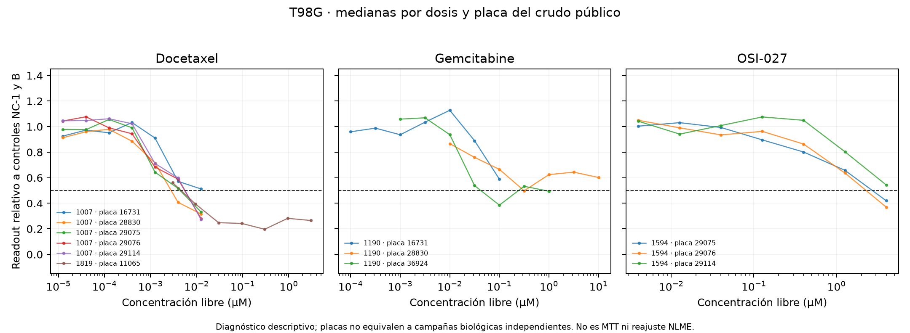

# Avance de los pendientes

Se adquirieron fuentes oficiales y se preparó un piloto revisable. Las mediciones de las nuevas formulaciones siguen pendientes; no se fabricaron ni se aprobaron candidatos automáticamente.

## Datos crudos y procedencia

Se descargó el ZIP público de GDSC2 8.5 y se leyeron 15,069,449 anotaciones sin extraer permanentemente el CSV de 2,11 GB. Se conservaron 470,780 anotaciones, que corresponden a 428,044 pozos físicos de 51 líneas y 514 placas. El CRC del miembro ZIP se verificó por lectura completa; cada archivo tiene recibo HTTP y SHA-256.

Los 12,001 ajustes locales coinciden con la distribución oficial en claves y cinco campos de respuesta, con tolerancia absoluta de 1e-12. Esto verifica la correspondencia de respuestas, no igualdad de bytes del Excel ni autenticidad de todas las anotaciones tumorales.

No se sumaron intensidades repetidas por etiquetas. El tag DMSO puede llevar DRUG_ID=4000: se conserva como solvente y no como un segundo fármaco. La normalización descriptiva usa sólo controles NC-1 y B explícitos; PC-1 y UN-USED no se reinterpretan como blancos. Las 514 placas tuvieron controles suficientes bajo esta regla operativa. No se sustituyó el QC original ni se reprodujo el modelo NLME. [Documentación primaria del formato](https://cog.sanger.ac.uk/cancerrxgene/GDSC_release8.5/GDSC_Raw_Data_Description.pdf).

## Qué muestran las curvas de los candidatos

| candidate | DRUG_ID | plate_drug_series | series_with_points_on_both_sides_of_half | series_all_above_half | raw_max_conc_um_by_series |
| --- | --- | --- | --- | --- | --- |
| Docetaxel | 1007 | 5 | 4 | 1 | 0.0125 |
| Docetaxel | 1819 | 1 | 1 | 0 | 3.0 |
| Gemcitabine | 1190 | 3 | 2 | 1 | 0.1;1.0;10.0 |
| OSI-027 | 1594 | 3 | 2 | 1 | 4.0 |



Hay variación entre placas y rangos de concentración. Para gemcitabina aparecen máximos de 0,1, 1 y 10 µM; el rango agregado del ajuste no debe atribuirse a cada experimento. Tener puntos a ambos lados de 50% es un diagnóstico empírico; no garantiza monotonicidad, precisión de IC50 ni una cota de censura calibrada. Las diferencias entre placas no se cuentan como réplicas biológicas independientes sin verificar expansión/lote.

En T98G se obtuvieron 403 series placa–fármaco normalizables. No todos los ajustes tienen una serie pública utilizable bajo estas reglas; se conserva la lista de ausencias sin inventar puntos ni sustituirlas por resistencia:

| DRUG_ID | DRUG_NAME |
| --- | --- |
| 1034 | Staurosporine |
| 1003 | Camptothecin |
| 1862 | MG-132 |
| 1060 | PD0325901 |

## Piloto y tamaño muestral

Se preparó una propuesta de 54 placas, con posiciones aleatorizadas, blancos, controles y una mezcla física adicional para discutir. Usa tres campañas para estimación inicial de variabilidad y tres pozos técnicos por condición; no afirma potencia confirmatoria. Las lecturas y dosis de fármaco dependientes de carga siguen vacías. Ver [propuesta completa para el laboratorio](piloto_para_revision.md).

Escenarios ilustrativos para una reducción de IC50 del 30%, con alpha familiar 0,05/3 y contraste pareado bilateral:

| loaded_to_free_ic50_ratio | hypothetical_paired_log_ratio_sd | per_comparison_alpha | power_if_n_3 | measured_variance | n_for_power_80pct | n_for_power_90pct |
| --- | --- | --- | --- | --- | --- | --- |
| 0.7 | 0.2 | 0.01667 | 0.16013 | False | 7.0 | 8.0 |
| 0.7 | 0.4 | 0.01667 | 0.05468 | False | 17.0 | 20.0 |
| 0.7 | 0.6 | 0.01667 | 0.03375 | False | 33.0 | 42.0 |
| 0.7 | 0.8 | 0.01667 | 0.02631 | False | 56.0 | 71.0 |
| 0.7 | 1.0 | 0.01667 | 0.02285 | False | 86.0 |  |

La SD de cada fila es hipotética. El tamaño confirmatorio no está fijado: requiere efecto relevante acordado y variabilidad medida en campañas independientes.

## Lo que sigue abierto

- Revisar identidad, forma comercial, ruta, sitio de unión y actividad/liberación de cada formulación.
- Medir carga/liberación por lote, controles MTT y readout ortogonal; incorporar el antecedente de oxaliplatino con sus datos instrumentales.
- Fijar efecto relevante, número confirmatorio y criterios de endotelio, barrera y recuperación en Transwell.
- Reajustar o modelar incertidumbre/censura con un protocolo justificado a partir de estos crudos; no convertir directamente las categorías descriptivas en etiquetas ciertas.

Listo para comparación formal: `False`; sigue sin aprobación. Decisiones aún sin valor: minimum_relevant_improvement, independent_experiments, endothelial_acceptance_criterion, transwell_analyte, barrier_integrity_criterion, transport_mass_balance_criterion, approved_by, approved_at.

## Reproducir

```bash
.venv/bin/python scripts/acquire_gdsc_sources.py
.venv/bin/python scripts/prepare_gdsc_raw.py
.venv/bin/python scripts/prepare_pilot.py
.venv/bin/python scripts/report_pending_progress.py
```

Todos los análisis y cambios de protocolo posteriores al holdout observado siguen siendo exploratorios.
